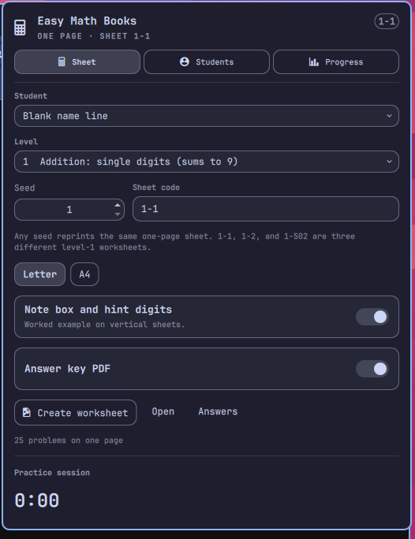
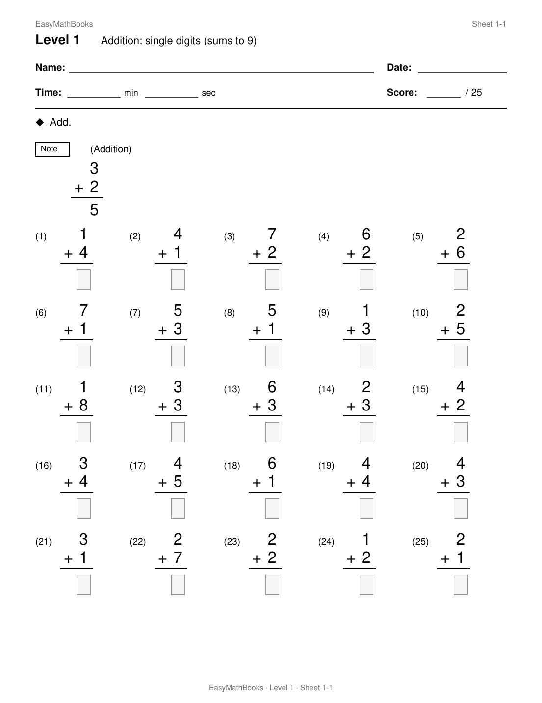
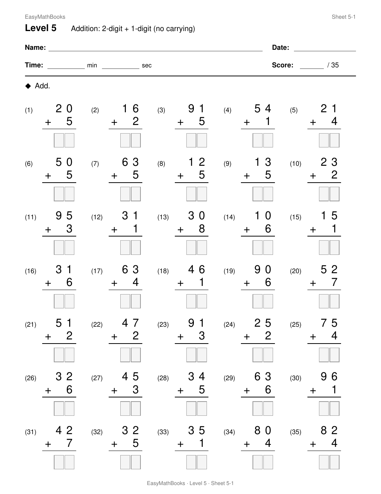

# Easy Math Books

Kumon-style math worksheets for the Omarchy bar. One printable page per sheet,
filled to capacity, plus a matching answer key. Sheet codes are deterministic:
**1-1** is level 1 seed 1, **1-502** is level 1 seed 502. The same code always
reprints the same problems.

| Panel | Sheet 1-1 | Sheet 5-1 |
|:---:|:---:|:---:|
|  |  |  |

Student names, practice times, and filled worksheets stay on this machine.
They are **not** in this repository. The first run creates
`~/.local/share/easymathbooks/easymath.db`.

## Install

```sh
omarchy plugin add https://github.com/guirossibrum/EasyMathBooks.git --enable
```

That clones this repository into `~/.config/omarchy/plugins/grbrum.easymath`
and places the calculator icon on the right of the bar. The first time you
create a worksheet, the plugin installs Python `reportlab` into
`~/.local/share/easymathbooks/venv` (not inside the plugin folder).

Dependencies: Python 3, [reportlab](https://pypi.org/project/reportlab/)
(pulled in automatically on first generate). License: MIT.

## Usage

Click the calculator icon to open the compact widget. On **Worksheet**, choose
student and level, then **Create & open worksheet**. The app opens the PDF and
moves to practice for that exact sheet. Start the timer or enter minutes and
seconds afterward, record the number correct, and save. Saving opens **Progress**.
Use **Prepare next worksheet** when printing several sheets.

The **gear** holds paper size, worked examples, answer keys, reprinting by sheet
code, and student management. Student profiles offer Male/Female and three
report motifs for each: flowers/unicorns/butterflies or sports/cars/airplanes.
Existing students keep their records and use a neutral stars report until a
profile is chosen. Widget pages fit without scrolling; recent practice entries
use pagination.

On **Progress**, open a personal **math journey** report for the last 30 days or
all practice. The self-contained HTML report opens locally in the browser:
print it, save it as PDF, show the detailed practice journal, or use **TV view**.
Reports live under `~/.local/share/easymathbooks/output/reports/`. There are no
external fonts, images, accounts, or network requests.

See the [UI review gallery](docs/ui-review/README.md) for fictional student
screenshots, all six printable report designs, and the TV preview.

Escape closes the panel. Right-click the icon to print the current sheet.

```sh
omarchy bar move grbrum.easymath --section right
omarchy-shell shell summon grbrum.easymath '{}'
```

CLI from a checkout:

```sh
python generate.py --list
python generate.py --sheet 1-1
python generate.py --sheet 1-502
python generate.py --level 1 --sheets 5
```

## Remove

```sh
omarchy plugin remove grbrum.easymath
```

That removes the bar widget and the cloned plugin folder. It does not delete
`~/.local/share/easymathbooks/` (students and past worksheets). Remove that
directory yourself if you want a clean slate.

## How a page is prepared

There are **40 levels**. Each one is a problem generator plus a page layout
(columns, row height, type size).

1. A sheet code `{level}-{seed}` seeds a private RNG (`EasyMathBooks:2-2`).
   Seed has no upper bound. The same code always reprints the same problems.
2. The level’s generator keeps drawing problems of that kind until the page
   is full. Illegal draws (wrong carry, negative difference, and so on) are
   rejected and tried again, so every item matches that level’s rule.
3. Capacity is how many rows fit times the column count. A **Note** (worked
   example) on vertical pages eats a band of height, so you get fewer problems
   (about 25 vs about 35 on the same level).
4. Early levels print **stacked** (digits in columns, answer boxes). Later
   levels print **horizontal** (`… = ____`) or **equations** (`x = ____`).
5. One PDF page, filled to capacity, plus an answer key.

## Levels

**Addition and subtraction (1–13)** — stacked arithmetic, Kumon-style.

| Level | What it drills |
|:---:|---|
| 1 | Single-digit add, sums to 9 |
| 2 | Single-digit add, sums 10–18 |
| 3 | Single-digit subtract |
| 4 | Teens minus a single digit |
| 5 | 2-digit + 1-digit, no carrying |
| 6 | 2-digit + 1-digit, carrying |
| 7 | 2-digit − 1-digit |
| 8 | 2-digit + 2-digit, no carrying |
| 9 | 2-digit + 2-digit, carrying |
| 10 | 2-digit − 2-digit |
| 11 | 3-digit + 3-digit |
| 12 | 3-digit − 3-digit |
| 13 | Mixed 4-digit add or subtract |

**Multiplication (14–18)** — stacked.

| Level | What it drills |
|:---:|---|
| 14 | Tables 2–5 × 2–9 |
| 15 | Tables up to 12 × 12 |
| 16 | 2-digit × 1-digit |
| 17 | 2-digit × 2-digit |
| 18 | 3-digit × 2-digit |

**Division (19–21)** — horizontal.

| Level | What it drills |
|:---:|---|
| 19 | Basic facts (exact) |
| 20 | Larger dividends, no remainder |
| 21 | With remainders |

**Fractions, decimals, percent (22–27)**

| Level | What it drills |
|:---:|---|
| 22 | Add/subtract, same denominator |
| 23 | Different denominators |
| 24 | Multiply and divide fractions |
| 25 | Decimal add/subtract |
| 26 | Decimal multiply/divide |
| 27 | Percentages |

**Integers and structure (28–32)**

| Level | What it drills |
|:---:|---|
| 28 | Negative add/subtract |
| 29 | Negative multiply/divide |
| 30 | Order of operations |
| 31 | Squares, cubes, powers |
| 32 | Exponent rules and negative powers |

**Roots (33–35)**

| Level | What it drills |
|:---:|---|
| 33 | Square and cube roots of perfect powers |
| 34 | Simplifying square roots |
| 35 | Arithmetic with square roots |

**Algebra (36–40)** — solve for *x*.

| Level | What it drills |
|:---:|---|
| 36 | One-step equations |
| 37 | Two-step equations |
| 38 | Variables on both sides |
| 39 | Equations with *x*² |
| 40 | Quadratics by factoring |
