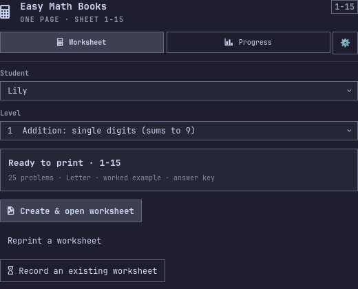
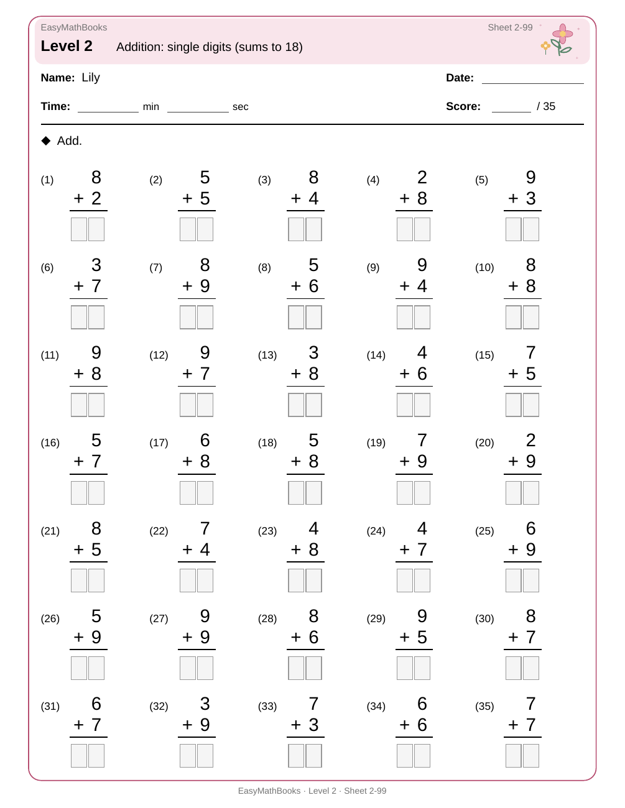
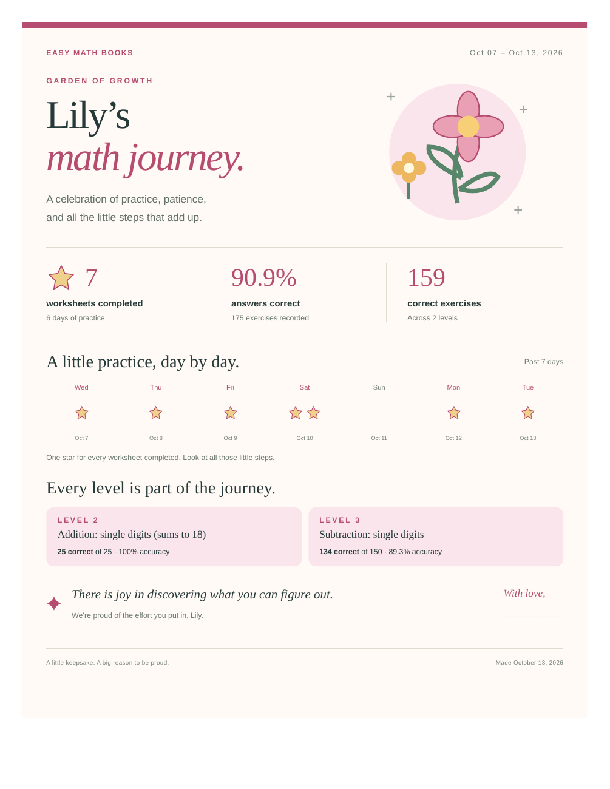
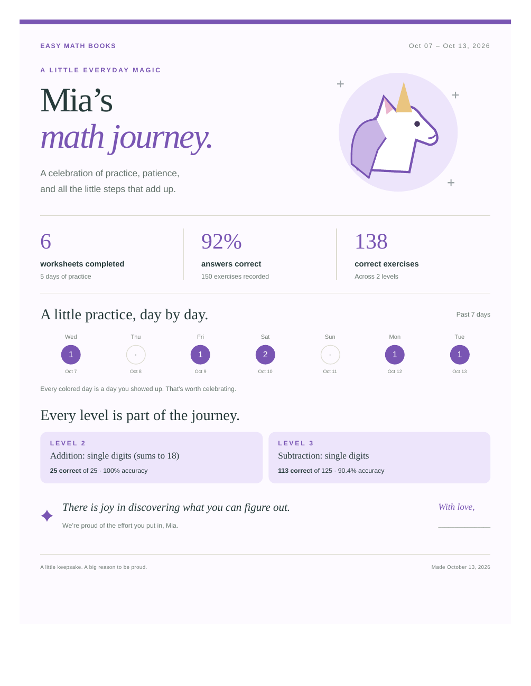
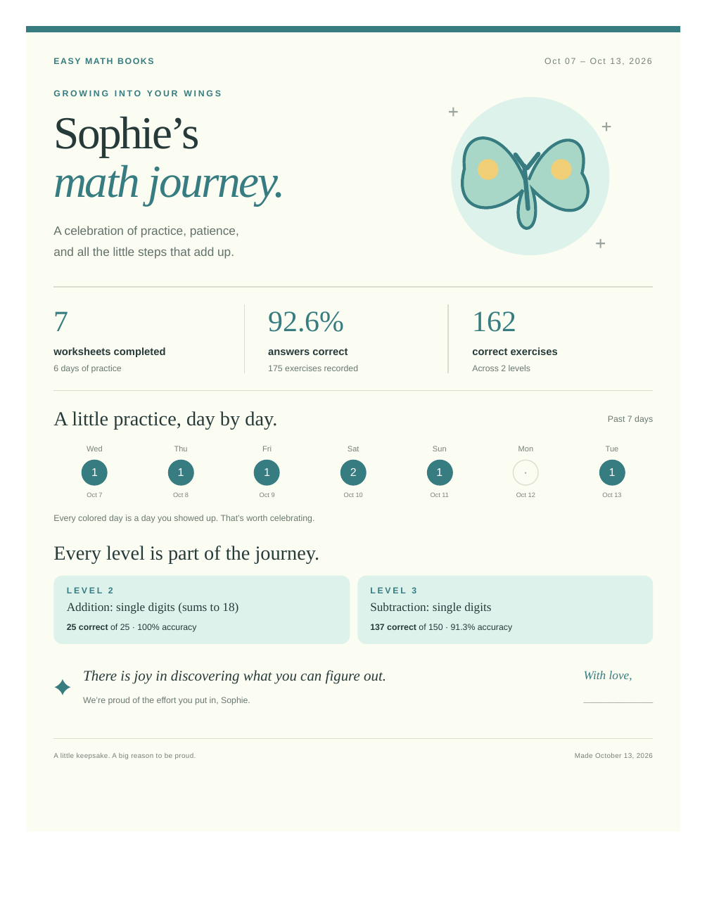
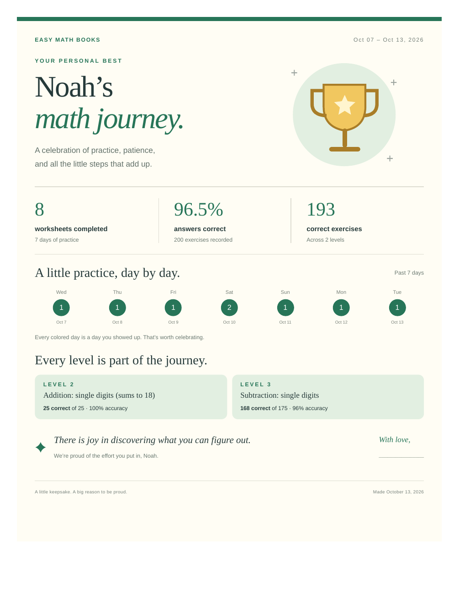
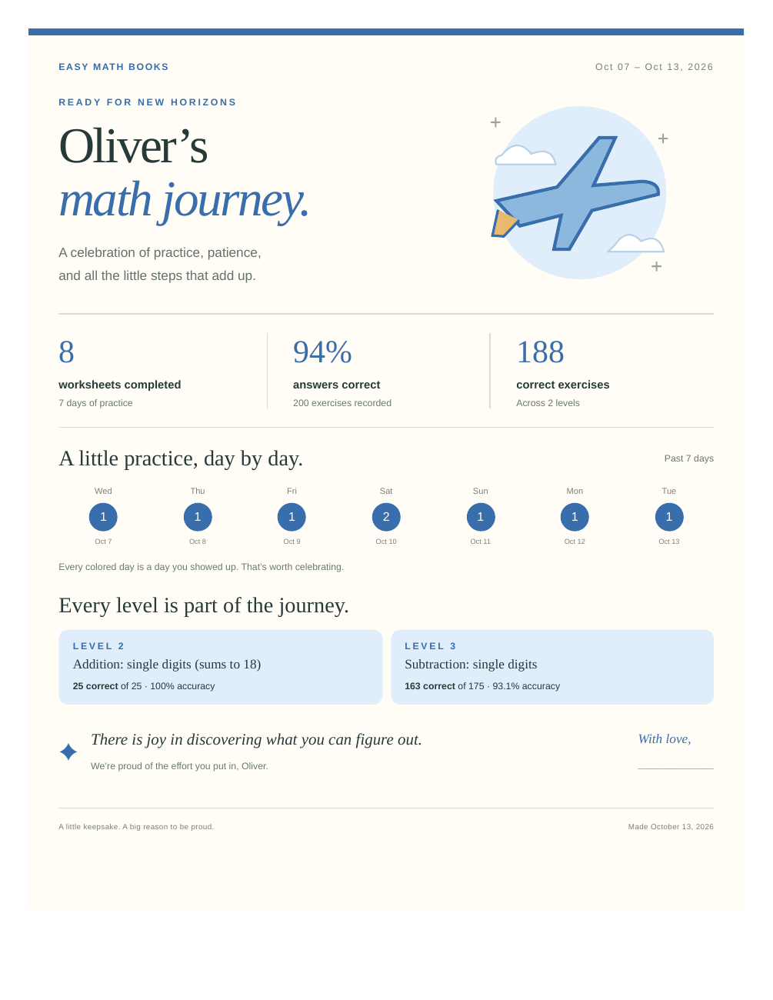

# Easy Math Books

**A little math practice. A beautiful record of growing up.**

An Omarchy bar widget for creating printable math worksheets, recording practice,
and turning a child's weekly effort into a keepsake parents can print, save, or
put on the TV. Everything stays on your computer.


## From practice to something worth keeping

| A compact widget | A personal worksheet | A report for the whole family |
|:---:|:---:|:---:|
|  |  |  |

- **40 math levels**, from single-digit addition to factoring quadratics.
- **Deterministic sheet codes.** `2-3` always reproduces the same exercise plan.
- **A simple flow:** choose student and level → create → time/score → save → progress.
- **No scrolling inside the widget.** Every child page has the same left-arrow Back control, returning to the page you came from. Escape also goes Back; at the root, it closes the widget.
- **Reprint unfinished sheets.** Replace a lost worksheet with the same problems and original print settings, or record its result.
- **Weekly keepsakes.** Past seven days by default; select any earlier week with results from Progress.
- **A star for every finished worksheet.** The weekly timeline celebrates each completed sheet, with a larger star beside the total.
- **Every practiced level counts.** Each level has its own results card, alongside total correct exercises and overall accuracy.
- **Timing is optional.** Off by default; parents can choose a report that celebrates correct answers without showing speed comparisons.
- **52 positive messages**, one for each week of the year.
- **Optional local reminders**, with independent toggles, a parent-entered missed-day threshold, and a parent-chosen notification time.

## Choose their personal touch

Student profiles offer **Female** or **Male**, with three motifs each. A profile
can be changed anytime. Existing students keep their records and use a neutral
stars design until a motif is explicitly saved.

| Flowers | Unicorns | Butterflies |
|:---:|:---:|:---:|
| [](docs/showcase/report-flowers.pdf) | [](docs/showcase/report-unicorns.pdf) | [](docs/showcase/report-butterflies.pdf) |

| Sports | Cars | Airplanes |
|:---:|:---:|:---:|
| [](docs/showcase/report-sports.pdf) | [](docs/showcase/report-cars.pdf) | [](docs/showcase/report-airplanes.pdf) |

Worksheets can stay **plain** for economical printing or **match the student's
motif** with colorful stationery. The exercise plan and writing space stay the
same. Answer keys are available separately.

## A weekly report, your way

**Progress → Open past 7 days report** opens a local HTML document in your browser.
**Progress → Choose a previous week’s report** opens the archive of
Monday–Sunday weeks with saved results. Timing can be changed there or in the
gear’s **Report preferences**.

The keepsake includes worksheet count, accuracy, total correct exercises, seven
days of activity, results for every practiced level, a positive weekly message,
and room for a parent to sign. Use **Print / save PDF** to keep it on paper or as
a PDF. **Show practice journal** reveals detailed results and includes them when
printing. The timing preference applies to that journal too.

**TV view** presents the keepsake fullscreen, without the journal button. Escape
exits fullscreen. The file needs no account, external fonts, images, or network
connection, so it can be copied to another device.


## Reminders belong to the parent

Both reminder switches start **off**. The first enable asks for permission to
send local Omarchy notifications. Each student has independent preferences:

| Option | Parent control |
|---|---|
| Weekly report reminder | A separate on/off switch; one reminder per new week when the preceding week has results. |
| Missed-practice reminder | A separate on/off switch; type how many days without recorded practice are acceptable. |
| Days without practice | Enter **1** for the first missed day, **3** for three days, or another number from 1–365. |
| Reminder time | Enter a local **24-hour time**, such as `18:00`, then save. Both reminder types use that time. |

After the selected day threshold, missed-practice notifications occur at most
once a day, after the chosen time, until practice is recorded again. Weekly
notifications occur after the chosen time on the first running day of the new
week. Reminders work while the widget is loaded in Omarchy and check once a
minute; no background service or external account is installed.

## Install

```sh
omarchy plugin add https://github.com/guirossibrum/EasyMathBooks.git --enable
```

Uses Omarchy's system Python and its existing Cairo, Pango, and SVG libraries
to produce sharp, printable PDFs. No package downloads or virtual environment
are needed. License: MIT.

The calculator icon opens the widget. **Worksheet** is for preparation and
practice; **Progress** is for results and reports. The **gear** opens a small settings hub for print options, reminder
preferences, student profiles, and report preferences. Reprinting stays in
**Worksheet**, and report actions stay in **Progress**.
Right-clicking the calculator creates the current worksheet.

## Your family's data stays local

Names, practice results, notification preferences, worksheets, and reports are
stored under `~/.local/share/easymathbooks/` (or your `XDG_DATA_HOME`). They are
never uploaded to this repository. Notifications go only to your local desktop.
The app's data directory is owner-only (`0700`), and its database and SQLite
sidecar files are private (`0600`). Existing installations receive these
permissions automatically while keeping their records and preferences.
The widget sends requests to its helper through stdin. Documents open through
private copies with opaque filenames, keeping child names out of process arguments.
All screenshots and downloadable examples in this README use **fictional students**.

Removing the widget preserves your records:

```sh
omarchy plugin remove grbrum.easymath
```

## Generate worksheets from the command line

You can also create worksheets directly with Python:

```sh
/usr/bin/python3 generate.py --list
/usr/bin/python3 generate.py --sheet 1-502
/usr/bin/python3 generate.py --level 1 --sheets 5
```

## How a page is prepared

There are **40 levels**. Each one is a problem generator plus a page layout
(columns, row height, type size).

1. A sheet code `{level}-{seed}` seeds a private RNG (`EasyMathBooks:2-2`).
   Seed has no upper bound. The same code always reprints the same problems.
2. The level’s generator keeps drawing problems of that kind until the page
   is full. Illegal draws (wrong carry, negative difference, and so on) are
   rejected and tried again, so every item matches that level’s rule.
3. Capacity is how many rows fit times the column count. A **Note** (worked
   example) on vertical pages eats a band of height, so you get fewer problems
   (about 25 vs about 35 on the same level).
4. Early levels print **stacked** (digits in columns, answer boxes). Later
   levels print **horizontal** (`… = ____`) or **equations** (`x = ____`).
5. One PDF page, filled to capacity, plus an answer key.

## Levels

**Addition and subtraction (1–13)** — stacked arithmetic, Kumon-style.

| Level | What it drills |
|:---:|---|
| 1 | Single-digit add, sums to 9 |
| 2 | Single-digit add, sums 10–18 |
| 3 | Single-digit subtract |
| 4 | Teens minus a single digit |
| 5 | 2-digit + 1-digit, no carrying |
| 6 | 2-digit + 1-digit, carrying |
| 7 | 2-digit − 1-digit |
| 8 | 2-digit + 2-digit, no carrying |
| 9 | 2-digit + 2-digit, carrying |
| 10 | 2-digit − 2-digit |
| 11 | 3-digit + 3-digit |
| 12 | 3-digit − 3-digit |
| 13 | Mixed 4-digit add or subtract |

**Multiplication (14–18)** — stacked.

| Level | What it drills |
|:---:|---|
| 14 | Tables 2–5 × 2–9 |
| 15 | Tables up to 12 × 12 |
| 16 | 2-digit × 1-digit |
| 17 | 2-digit × 2-digit |
| 18 | 3-digit × 2-digit |

**Division (19–21)** — horizontal.

| Level | What it drills |
|:---:|---|
| 19 | Basic facts (exact) |
| 20 | Larger dividends, no remainder |
| 21 | With remainders |

**Fractions, decimals, percent (22–27)**

| Level | What it drills |
|:---:|---|
| 22 | Add/subtract, same denominator |
| 23 | Different denominators |
| 24 | Multiply and divide fractions |
| 25 | Decimal add/subtract |
| 26 | Decimal multiply/divide |
| 27 | Percentages |

**Integers and structure (28–32)**

| Level | What it drills |
|:---:|---|
| 28 | Negative add/subtract |
| 29 | Negative multiply/divide |
| 30 | Order of operations |
| 31 | Squares, cubes, powers |
| 32 | Exponent rules and negative powers |

**Roots (33–35)**

| Level | What it drills |
|:---:|---|
| 33 | Square and cube roots of perfect powers |
| 34 | Simplifying square roots |
| 35 | Arithmetic with square roots |

**Algebra (36–40)** — solve for *x*.

| Level | What it drills |
|:---:|---|
| 36 | One-step equations |
| 37 | Two-step equations |
| 38 | Variables on both sides |
| 39 | Equations with *x*² |
| 40 | Quadratics by factoring |
