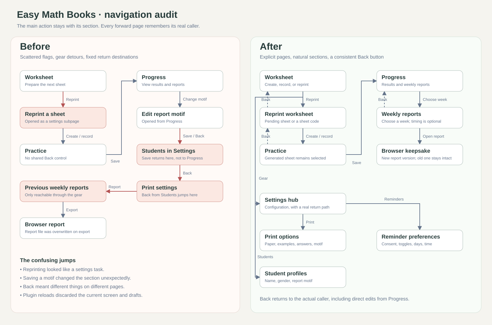
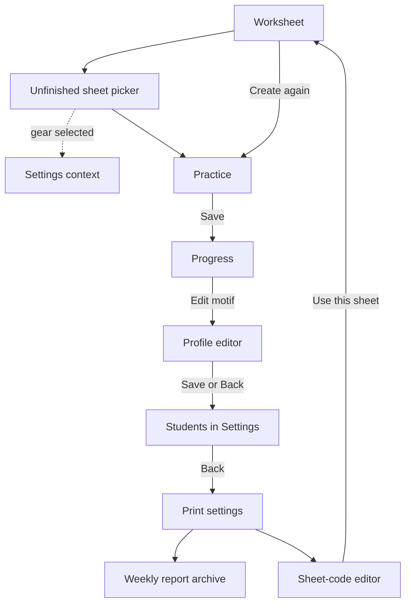
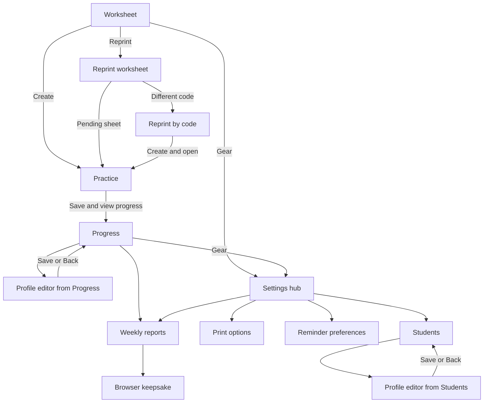

# Stability and navigation audit

Reviewed after reports of a disappearing widget while saving reminder preferences and a Chromium crash when regenerating a motif report. This audit covers the application's UI routes, subprocess protocol, report writes, reminder persistence, worksheet/reprint behavior, and the recorded system failures.

## What the evidence establishes

| Finding | Evidence | Resolution |
|---|---|---|
| Chromium suffered a system swap-read failure | At **2026-10-13 23:03:23 CDT**, the kernel identifies `chromium/131437` in `zram_submit_bio`, followed by `zram: Decompression failed! err=-22` and a swap-device read error. Its core records **SIGBUS / BUS_ADRERR**. Two unrelated processes also suffered SIGBUS after an earlier zram error at 22:58. | The system's compressed-swap failure is confirmed. The underlying cause of that failure is not diagnosed here. No swap, kernel, or hardware settings were changed. An app UI change cannot be claimed to fix this system issue. |
| The widget reloaded itself during ordinary actions | No Quickshell core is recorded in the examined interval, while the running shell repeatedly logs `Local plugin changed, reloading: grbrum.easymath`. The shell watches all files recursively. Python created plugin-local bytecode at 23:01:52 (`reminders`) and 23:03:23 (`report` and `encouragement`). | The CLI now disables bytecode writes with `PYTHONDONTWRITEBYTECODE=1` and `-B`. A copied-plugin integration test runs reminder saves, motif saves, report export, and reminder checks and verifies that no plugin files change and no `__pycache__` is created. This removes a demonstrated reload trigger; it does not prove every reported disappearance had that cause. |
| Reprinting was presented as Settings | The previous click handler enabled settings mode to load the unfinished-sheet picker, highlighting the gear. Arbitrary reprinting required choosing a code, returning to Worksheet, then clicking Create. | Reprinting is now a direct Worksheet route. A saved pending sheet can be reprinted in one action; a different code has its own direct Create & open action. Editing a reprint code leaves the upcoming worksheet untouched. |
| Back destinations were hard-coded | Editing a motif from Progress returned to Students; Students returned to Print settings. Each subpage implemented a different Back handler. | One explicit page state and one history stack supply the same Back control on every child page. Saving a profile returns to its caller. Saving practice explicitly completes the flow at Progress. |
| Student-specific sheets could lose to a generic print | The lookup ordered nonmatching/NULL students before the selected student; the no-student lookup could also return another child’s PDF. | Lookup now prefers an exact student match, falls back to an unassigned sheet only when needed, and keeps blank-name selection isolated. A multi-student regression covers PDF identity and problem counts. |
| Dropdown overlay parent had a binding loop | Earlier live logs identify `AppSearchableDropdown.qml`’s overlay parent. The attached `Overlay.overlay` was resolved from the reparented layer itself. | Both menus now resolve the overlay from their stable root item. |
| Helper requests could overwrite one another | A single `pendingCmd` slot kept only the last queued command. Output parsing occurred in a stdout completion callback rather than the process-exit handler. | Mutating commands now queue in order. Only consecutive selection snapshots coalesce. Parsing follows process exit; invalid/error replies clear busy state and retain the page. A real-QML integration check exercises queued saves and recovery after rejected input. |
| Reminder drafts disappeared on leaving the page | The Loader destroyed controls whose values were bound directly to stored preferences. | Day/time drafts live in widget state and survive Back. Notes are retained as they are typed too. |
| Confirmation keys were not wired to the dialog | The root key handler returned while a confirmation was open, without calling the UI kit's `handleKey` method. | Modal keys are routed to the confirmation dialog; Escape cancels it rather than changing the underlying route. |
| Export replaced the HTML file already open in the browser | `write_report` used the same period filename and `write_text`, truncating and rewriting it on every export. | Reports use content-versioned filenames and atomic publication. Identical output reuses the same file; a changed motif/result creates a new version without modifying the open document. This is independent hardening, not the cause assigned to Chromium's zram SIGBUS. |

The 22:03 Chromium SIGTRAP record belongs to an earlier headless rendering attempt, not the later desktop-browser SIGBUS incident. Memory and disk were not exhausted at inspection: approximately 17 GiB RAM was available, and `/tmp` and `/dev/shm` had ample free space. Those current values alone do not establish historical peak usage. No OOM kill appeared in the inspected kernel interval.

Saved application data is separate from the plugin and is preserved by these changes. A reload could have discarded unsaved form state; there is no reliable way to reconstruct that state from a closed widget.

## Before: routes and unexpected returns

## After: actions stay with their section

Every forward route pushes its caller. The persistent left-arrow control and Escape pop exactly one page. Opening Settings from Weekly reports and returning therefore restores Weekly reports, rather than forcing Worksheet. Top-level Worksheet/Progress buttons deliberately start a fresh root route. Saving a completed practice session clears its history to prevent going Back to an already-saved form.

## Validation and limits

- Python tests cover report periods, multiple levels, timing omission, motifs, reminder consent/threshold/time/deduplication, original reprint settings, stable report versions, and absence of plugin-local writes.
- `tools/preview_ui.py` checks navigation, profile returns, reminder draft retention, failure-state recovery, and all bounded screen layouts using fake data.
- `tools/check_runtime.py` exercises the actual QML `Process` and CLI against a temporary database: queued saves, invalid input, motif edits, report regeneration, and preserved return context. `--missing-helper` also checks process-start failure. It never opens a browser or sends notifications.
- Browser previews and PDF checks use fictional students. No private core contents or actual student records are included in this audit.
- The zram failure remains a separate system investigation. Debug symbols were unavailable in the recorded Chromium stack; the diagnosis rests on the matching kernel task, signal, and swap-read failure, not invented Chromium function names.
