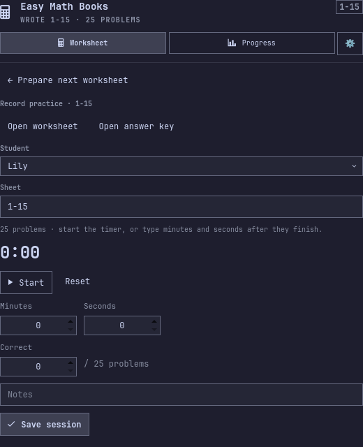
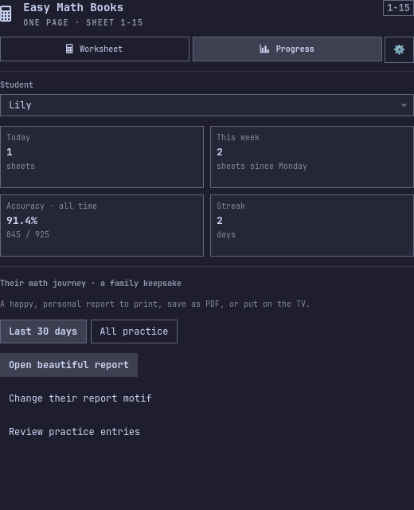
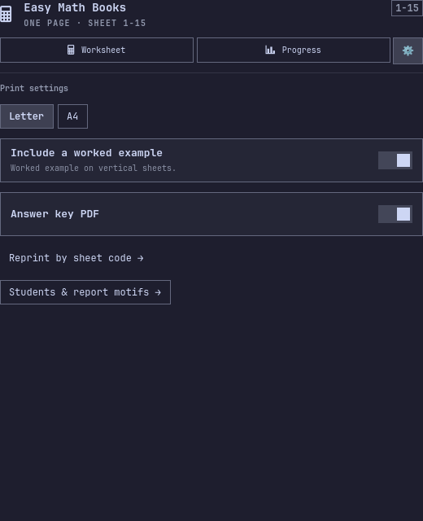
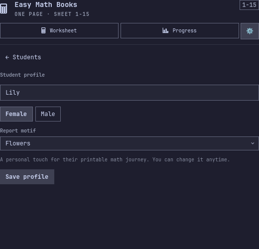
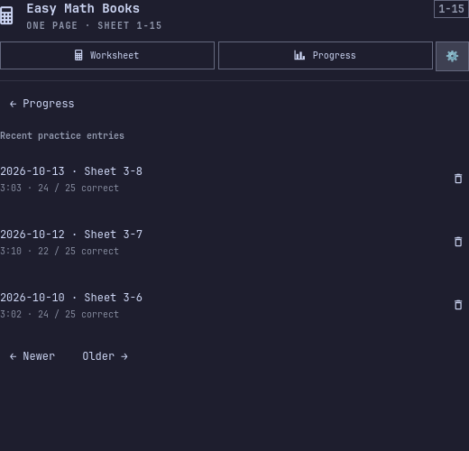
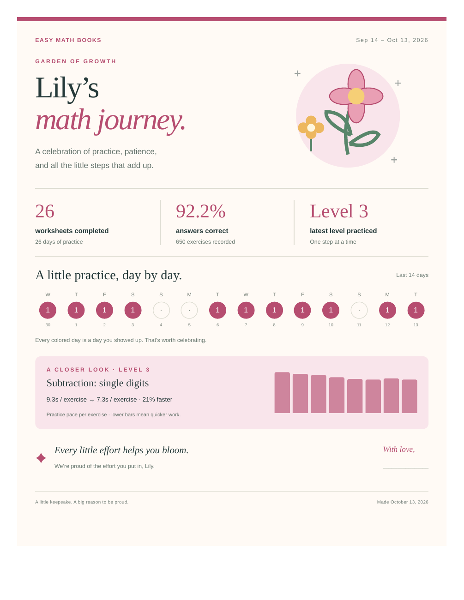
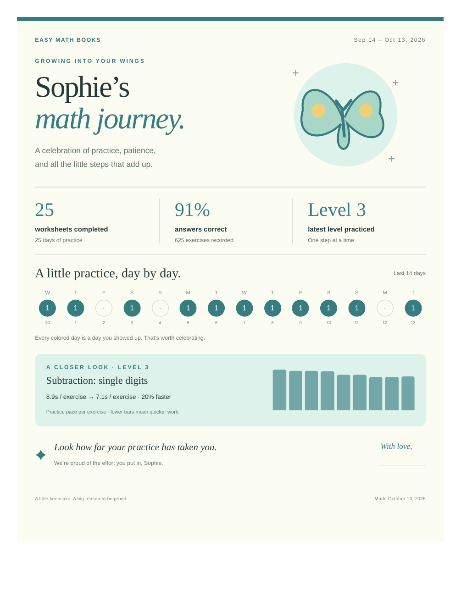
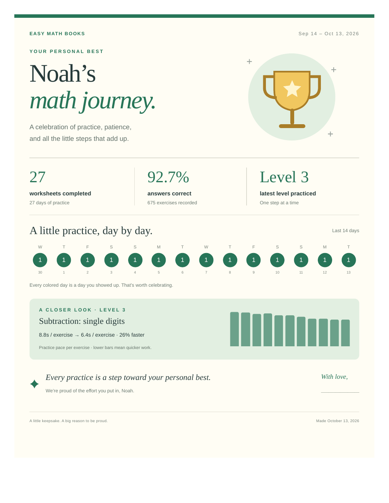
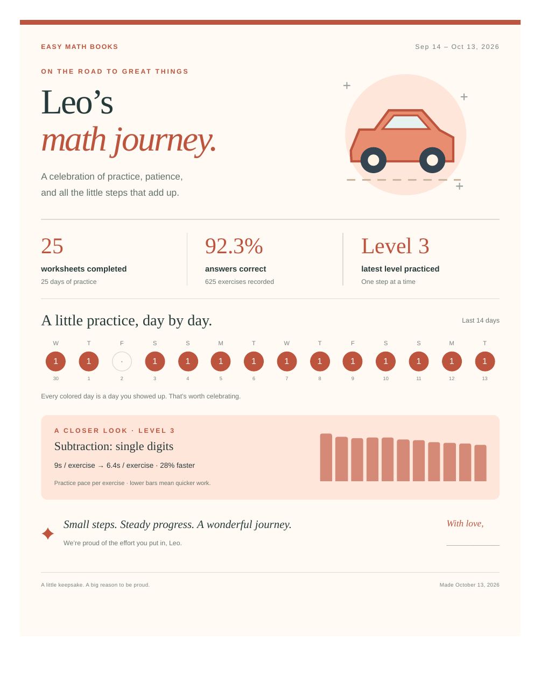
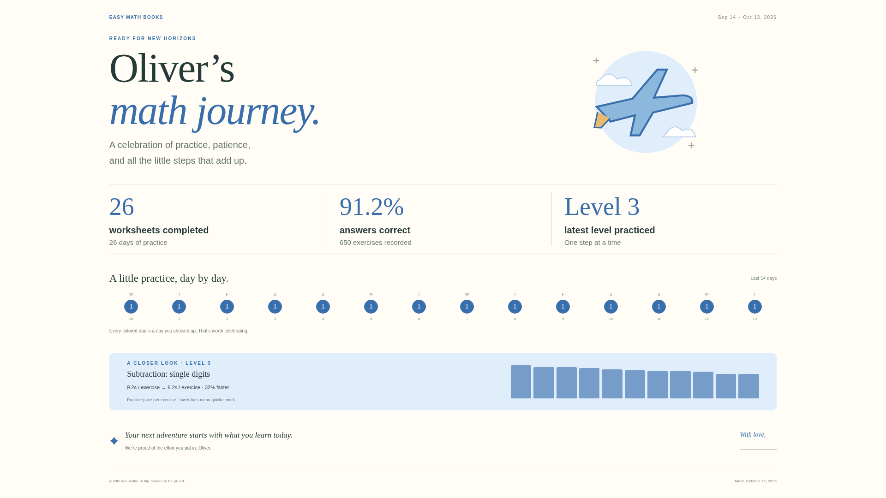

# UI experiment · dev/ui-review

Everything in this gallery uses a separate, fictional database: six students and 45 days of sample activity. Real student data and the installed desktop plugin were not changed.

## Review the widget

The main navigation now has **Worksheet**, **Progress**, and a **gear**. Creating a sheet opens the practice step for that exact sheet; saving opens Progress. The gear holds print settings, reprinting, and student profiles. Each screen fits immediately, with no scrolling. Practice history uses three entries per page.

| Prepare a worksheet | Record practice | Progress & report |
|---|---|---|
|  |  |  |

| Print settings | Student profile | Practice entries |
|---|---|---|
|  |  |  |

Also see [student management](students.png) and [reprinting](reprint.png).

## Review the keepsakes

These are real browser renders and PDF print previews. Each report is a standalone HTML file with inline vector artwork, styling, and controls. It works offline. **Print / save PDF** prints the one-page keepsake. **Show practice journal** reveals the detailed level and session tables and includes them in printing. **TV view** presents the keepsake fullscreen; Escape exits fullscreen.

The report includes a 30-day or all-time summary, activity, pace alongside accuracy, an encouraging message, and a parent signature line. It celebrates effort without treating a day off or a slower session as a failure. Gender choices are Male/Female. Existing students retain their data and receive a neutral stars design until a profile is chosen.

| Flowers · Lily | Unicorns · Mia | Butterflies · Sophie |
|---|---|---|
| [](report-flowers.pdf) | [](report-unicorns.pdf) | [](report-butterflies.pdf) |
| [Open HTML](report-flowers.html) · [PDF](report-flowers.pdf) | [Open HTML](report-unicorns.html) · [PDF](report-unicorns.pdf) | [Open HTML](report-butterflies.html) · [PDF](report-butterflies.pdf) |

| Sports · Noah | Cars · Leo | Airplanes · Oliver |
|---|---|---|
| [](report-sports.pdf) | [](report-cars.pdf) | [](report-airplanes.pdf) |
| [Open HTML](report-sports.html) · [PDF](report-sports.pdf) | [Open HTML](report-cars.html) · [PDF](report-cars.pdf) | [Open HTML](report-airplanes.html) · [PDF](report-airplanes.pdf) |



## Reproduce

From the repository root, using its Python environment:

```sh
.venv/bin/python tools/create_demo.py
.venv/bin/python tools/preview_ui.py
.venv/bin/python tools/render_reports.py
.venv/bin/python -m unittest discover -s tests
```

`create_demo.py` retains the fake database at `output/ui-review/demo/easymathbooks/easymath.db`, excluded from Git. It is repeatable and does not delete an existing database. `preview_ui.py` makes a temporary copy, verifies the create/practice/save transitions and screen fit, and renders the actual QML components offscreen using the installed Omarchy UI kit. Desktop popup placement and compositor keyboard focus still need a live desktop check. The installed plugin has not been replaced.

`render_reports.py` uses an isolated headless Chromium profile plus `pdfinfo` and `pdftoppm`. It checks that each keepsake PDF is exactly one page and captures the screen, print, and TV previews. Browser printing can also save a PDF without installing a new Python dependency.

## Further improvements worth considering

- A weekly or monthly family report archive with a small personal note from the parent.
- Optional worksheet cover art using the same motif, while keeping the exercises quiet and easy to read.
- An explicit parent-selected practice schedule so streaks reflect planned practice days.
- A small print preview before creating worksheets, especially when worked examples change the problem count.

The worksheet's monochrome arithmetic layout remains useful: large digits, generous writing space, and low printing cost. The family report supplies the color and celebration.
